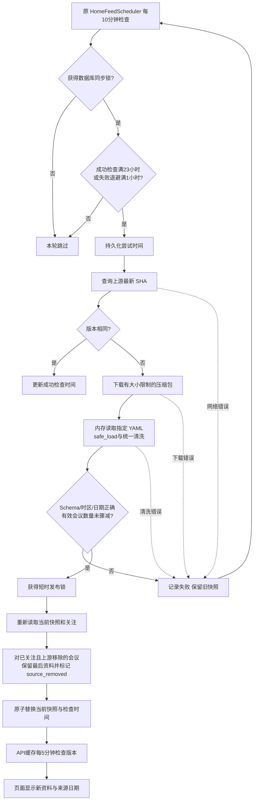
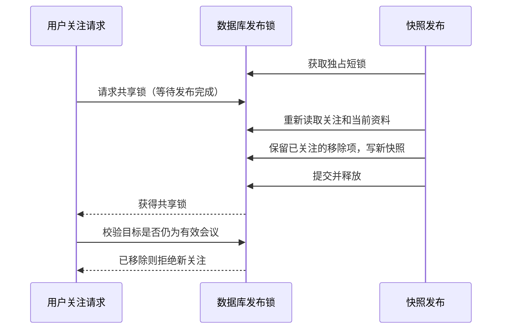
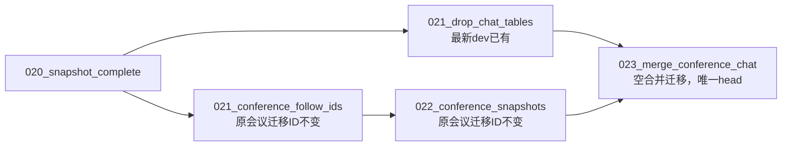

# 会议 DDL 自动同步设计

## 目标与边界

在原有会议 DDL 上接入上游 YAML → 统一清洗校验 → 数据库当前快照 → 缓存 → 页面。保留原时区、当届选择、排序和筛选，响应只新增字段。忽略 rebuttal_deadline / decision_deadline；不新增依赖、后台录入或通用会议别名系统。

## 目录与职责

- `app/integrations/conferences/client.py`：版本查询、下载和压缩包输入防护。
- `app/services/conferences/catalog.py`：快照校验、时区换算、当届选择和查询。
- `app/services/conferences/source.py`：共用 YAML 清洗。
- `app/services/conferences/repository.py`：数据库快照、缓存和已移除关注资料保留。
- `app/services/conferences/sync.py`：到期、重试、版本比较和同步编排。
- `app/services/conferences/cli.py`：发布、校验和手动同步。
- `app/services/conferences/__init__.py`：保留原有公共目录查询导入接口。
- API、Schema、Model 仍各归现有层，不全部塞入 Service。

## 核心流程



## 上游移除会议

删除单条已关注会议不再拒绝整份同步。发布事务持有短锁，重新读取关注与旧快照，将缺失但仍被关注的会议作为历史记录保留，设置 `source_removed=true`。补回其历史分类，重新校验目录，并让快照版本包含保留资料的摘要。

对这类记录：保留原关注，公开响应新增 source_removed；不输出下一截稿节点，页面不显示旧倒计时/旧时间线/日历导出，显示“暂无最新会议数据”，并注明“目前保留最后一次资料，截稿信息请以会议官网为准”。允许取消关注，拒绝新关注。后续发布时，已无人关注的历史记录不再携带；上游重新出现同ID时采用上游新资料，恢复为正常记录。对无历史资料的异常旧关注只告警，不凭空生成会议，也不阻断其他更新。



如果关注先提交，发布后的重新查询能看到该关注，因此保留最后资料。下载期间不持有发布短锁，避免让用户等网络请求。整轮同步锁防止多个实例重复拉取；两把锁解决的是不同问题。

## 存储、缓存与保护

数据库用 id=1 保存一份当前 JSONB，以及 SHA、资料日期、同步/成功检查/失败尝试时间。不是按天保存全量历史；保留资料只服务仍被关注的移除会议。没有自动历史回滚后台。

SHA 未变不下载；API缓存五分钟检查小版本列，版本未变不读取整份JSON。并发缓存刷新合并。数据库异常保留最后已验证目录，冷启动才使用打包快照。页面每五分钟刷新查询。

会议数下降超过10%仍拒绝写入；比较基线只统计旧快照中的正常会议，不让保留的历史记录扩大基线。异常日期、时区、未知时间轴字段或坏Schema仍拒绝发布。所有失败保留旧数据，至少1小时后由后续调度再次尝试；数据库尝试时间使重启不丢退避。

压缩包只在内存读指定成员，不向磁盘解压；限制下载量、实际解压量、单文件和总YAML大小、成员数量，拒绝异常路径、链接和重复成员。YAML只使用safe_load。大块转换在线程中完成。

## 触发与实际环境

常驻后端复用 `HomeFeedScheduler`，会议 DDL、首页数据任务和论文库会议目录由 `BACKGROUND_JOBS_ENABLED` 统一启停，各任务独立判断是否到期。

最新dev部署文档仍将Vercel列为临时演示联调，正式服务器方式待负责人补充。会议记录中的裸机环境与文档记录不能代替实际验证。没有服务器访问权限时，不宣称已验证生产环境。Vercel Preview可检查构建/API，不能验收进程内任务每日自动执行。

## 配置和手动命令

先核对目标数据库与迁移状态，再按团队流程执行迁移。现有迁移ID保持不变：dev的 `021_drop_chat_tables` 与会议的 `021_conference_follow_ids` → `022_conference_snapshots` 各自从020发展，新增空合并迁移 `023_merge_conference_chat` 汇合为唯一head。这样已执行任一旧分支迁移的数据库仍能识别原ID，无需重写历史。dev的021会删除旧Chat表，生产执行需由负责人审核备份；不要直接拿旧分支的迁移编号向生产执行。

常驻后端设置 `CHAT_DATABASE_URL` 和 `BACKGROUND_JOBS_ENABLED=true`。共享 IP 限流时可配置服务端只读 `CONFERENCE_GITHUB_TOKEN`。密钥只放部署环境，不放代码或文档。

```bash
uv run --locked --env-file .env alembic upgrade head
uv run --locked --env-file .env python -m app.services.conferences.cli sync --dry-run
uv run --locked --env-file .env python -m app.services.conferences.cli sync
uv run --locked python -m app.services.conferences.cli publish --source /path/to/ccf-deadlines
uv run --locked python -m app.services.conferences.cli publish --source /path/to/ccf-deadlines --check
```

## 验收

离线测试不访问外网；新增删除会议保留、不能新关注、无倒计时、取消后下一版清理、上游恢复、缩量保护不受历史条目影响的测试。独立PostgreSQL验证迁移和发布/关注两种锁竞争顺序，禁止使用生产库作测试。

线上须由负责人确认实际服务进程和环境变量、到GitHub网络可达性，观察数据库SHA/checked_at、正常自动同步和失败退避恢复。持续上游故障时无法保证新鲜度，应保留旧数据并排查日志。代码测试通过不替代线上验收。

## 两个开发分支的迁移汇合



合并迁移本身不增删业务数据；它让Alembic先补齐缺少的另一条分支，再到达统一版本。对旧会议分支已经执行022的数据库也验证可升级。dev中删除旧Chat表是团队已有改动，不是本次会议功能额外删除；正式执行仍需负责人审查。
